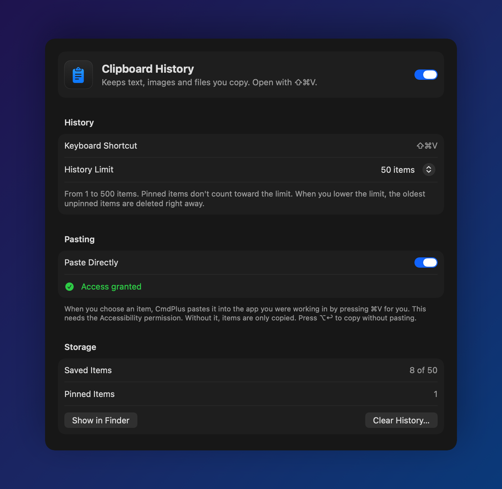
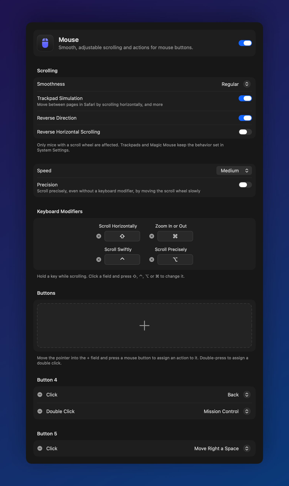
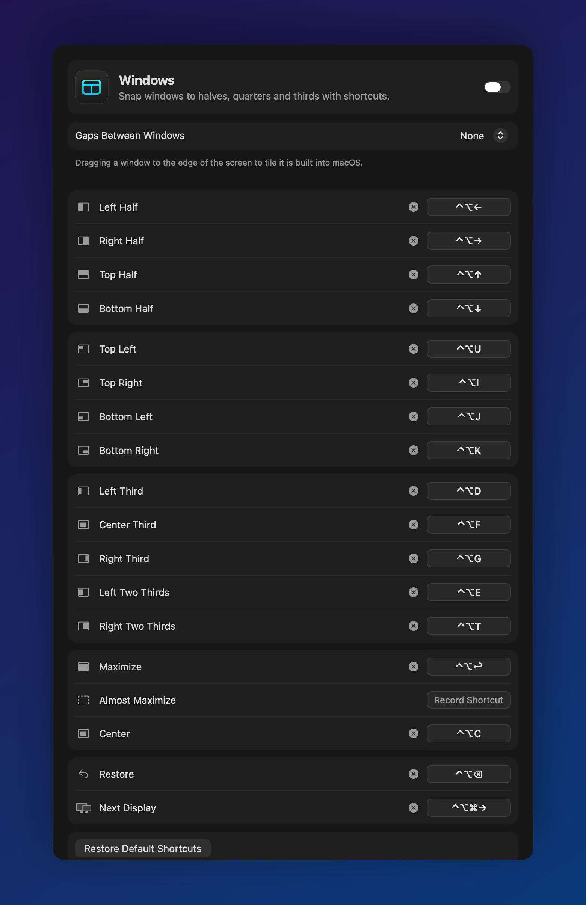

<div align="center">


# CmdPlus

**Small, native utilities for your Mac — all in one menu bar app.**

Free and open source. Fast, private, and built only with Apple's own frameworks.

[](#requirements)
[](#building)
[](LICENSE)

<br>

<picture>
  <source media="(prefers-color-scheme: dark)" srcset="docs/images/history-dark.png">
  <source media="(prefers-color-scheme: light)" srcset="docs/images/history-light.png">
  
</picture>

</div>

## Download

Grab the latest `CmdPlus-x.y.z.zip` from [**Releases**](https://github.com/GostWarrir186/CmdPlus/releases/latest), unzip it and move **CmdPlus** to **Applications**.

CmdPlus is free and isn't notarized by Apple, so macOS blocks the first launch. To allow it once:

1. Open CmdPlus. When macOS says it can't be opened, click **Done**.
2. Go to **System Settings → Privacy & Security**, scroll down and click **Open Anyway** next to CmdPlus.

Or run this in Terminal:

```sh
xattr -dr com.apple.quarantine /Applications/CmdPlus.app
```

> After each update, macOS may ask you to grant the Accessibility permission again.

## Why CmdPlus

Instead of a dozen separate menu bar apps, CmdPlus gives you one lightweight app with modules you can switch on and off.

- 🍏 **Native.** Swift and SwiftUI, system components only, designed for macOS 26 and Liquid Glass.
- ⚡️ **Light on resources.** Disabled modules aren't even loaded. Heavy work runs in the background.
- 🔒 **Private.** Everything stays on your Mac. No accounts, no servers, no analytics.
- 🧩 **Modular.** Use only what you need, and turn the rest off in Settings.

## Modules

| | Module | What it does |
| --- | --- | --- |
| 📋 | [Clipboard History](#clipboard-history) | Everything you copy, one shortcut away |
| 🖱️ | [Mouse](#mouse) | Smooth scrolling and actions for any mouse button |
| 🪟 | [Windows](#windows) | Snap windows to halves, quarters and thirds |

Every module can be turned on or off in **Settings**. Mouse and Windows are off until you turn them on.

### Clipboard History

Everything you copy (text, images, files) is one shortcut away.

- **⇧⌘V** opens a Spotlight-style window: the list is on the left, a full preview on the right.
- **Search by words** in any order, with matches highlighted. Filter by text, images, files or pinned.
- **Pick and it's pasted** straight into the app you were using. No extra ⌘V needed.
- **Drag and drop** items into any app: text as text, images as PNG, files as files.
- **Pin** what you use often. Pinned items never count toward the limit.
- **Set your own limit** from 1 to 500 items. The oldest unpinned ones are removed first.
- **Passwords are skipped.** Anything a password manager marks as secret (1Password, Bitwarden, Apple Passwords and others) is never saved.

<details>
<summary><b>Keyboard shortcuts</b></summary>
<br>

| Shortcut | Action |
| --- | --- |
| <kbd>⇧</kbd><kbd>⌘</kbd><kbd>V</kbd> | Open the history window, bring it forward, or close it |
| <kbd>↑</kbd> <kbd>↓</kbd> | Move the selection |
| <kbd>↩</kbd> or double-click | Paste the item |
| <kbd>⌥</kbd><kbd>↩</kbd> | Copy without pasting |
| <kbd>⌘</kbd><kbd>1</kbd> … <kbd>⌘</kbd><kbd>9</kbd> | Paste one of the first nine items |
| <kbd>⌘</kbd><kbd>P</kbd> | Pin or unpin |
| <kbd>⌘</kbd><kbd>⌫</kbd> | Delete |
| <kbd>esc</kbd> | Close |

</details>

<div align="center">

</div>

### Mouse

Make a regular mouse feel right on a Mac.

- **Smooth scrolling** for wheel mice — Off, Regular or High — with optional **trackpad simulation**, so apps like Safari react to the wheel like to a trackpad.
- **Speed** (Low, Medium, High) and **Precision**: move the wheel slowly for fine control.
- **Keyboard modifiers** while scrolling: scroll horizontally (⇧), zoom (⌘), scroll swiftly (⌃) or precisely (⌥) — all reassignable.
- **Reverse scrolling** for the wheel only. Trackpads and Magic Mouse keep the system settings.
- **Assign any extra button**: hover the **+** field and press the middle button, button 4, 5 or more. Single and double clicks can do different things.
- Actions include Look Up, Middle Click, Back/Forward, Mission Control, Application Windows, Show Desktop, Launchpad, switching Spaces, Clipboard History, Copy/Paste/Undo, New/Close Tab — or any **keyboard shortcut** you record.
- When there's nothing to do, it doesn't watch the mouse at all.

<div align="center">

</div>

### Windows

Put the window you're working in exactly where you want it — from the keyboard or the menu bar.

- **Halves, quarters, thirds and two thirds**, plus Maximize, Almost Maximize and Center.
- **Restore** puts a window back where it was before you snapped it.
- **Next Display** moves a window to your other screen, keeping its place and size.
- **Gaps** between windows: none, small or large.
- Every shortcut can be re-recorded or removed. Defaults match Rectangle, so switching is easy.
- The menu bar tile has one-click buttons for the most common layouts.

<details>
<summary><b>Default shortcuts</b></summary>
<br>

| Shortcut | Layout |
| --- | --- |
| <kbd>⌃</kbd><kbd>⌥</kbd><kbd>←</kbd> <kbd>→</kbd> <kbd>↑</kbd> <kbd>↓</kbd> | Left, right, top, bottom half |
| <kbd>⌃</kbd><kbd>⌥</kbd><kbd>U</kbd> <kbd>I</kbd> <kbd>J</kbd> <kbd>K</kbd> | Top left, top right, bottom left, bottom right |
| <kbd>⌃</kbd><kbd>⌥</kbd><kbd>D</kbd> <kbd>F</kbd> <kbd>G</kbd> | Left, center, right third |
| <kbd>⌃</kbd><kbd>⌥</kbd><kbd>E</kbd> <kbd>T</kbd> | Left, right two thirds |
| <kbd>⌃</kbd><kbd>⌥</kbd><kbd>↩</kbd> | Maximize |
| <kbd>⌃</kbd><kbd>⌥</kbd><kbd>C</kbd> | Center |
| <kbd>⌃</kbd><kbd>⌥</kbd><kbd>⌫</kbd> | Restore |
| <kbd>⌃</kbd><kbd>⌥</kbd><kbd>⌘</kbd><kbd>→</kbd> | Next display |

</details>

<div align="center">

</div>

### General

- **Open at Login**, quietly — just the menu bar icon, no windows.
- **Appearance**: System, Light or Dark.
- **Language**: System, English or Русский.

## Requirements

- macOS 26 or later
- To build: Xcode 27 or later

## Building

```sh
git clone https://github.com/GostWarrir186/CmdPlus.git
open CmdPlus/CmdPlus.xcodeproj
```

1. In **Signing & Capabilities**, choose your own team. The project is signed with the author's team by default.
2. Press <kbd>⌘</kbd><kbd>R</kbd>. CmdPlus appears in the menu bar. It has no Dock icon.

Run the tests with <kbd>⌘</kbd><kbd>U</kbd>, or from the terminal:

```sh
xcodebuild -project CmdPlus.xcodeproj -scheme CmdPlus -destination 'platform=macOS' test
```

<details>
<summary>Regenerating the README screenshots</summary>
<br>

Screenshots are rendered from demo data by a test, so no real clipboard history ends up in the repo:

```sh
TEST_RUNNER_CMDPLUS_SCREENSHOTS=1 xcodebuild test -project CmdPlus.xcodeproj -scheme CmdPlus \
  -destination 'platform=macOS' -testLanguage en -only-testing:CmdPlusTests/ReadmeScreenshots \
  | grep '^SCREENSHOT ' | while read _ name data; do echo "$data" | base64 -D > "docs/images/$name.png"; done
```

</details>

## Permissions

CmdPlus asks for a permission only when you turn on the feature that needs it, and always explains why.

| Permission | Used for |
| --- | --- |
| **Accessibility** | Clipboard History: pasting a picked item for you by sending ⌘V (without it, items are only copied). Mouse: changing scrolling and handling buttons. Windows: moving and resizing other apps' windows. |

## Privacy

- Settings are stored in `UserDefaults`.
- History is stored in `~/Library/Application Support/CmdPlus/`.
- CmdPlus doesn't use the App Sandbox: macOS doesn't let sandboxed apps move other apps' windows. That's also why it's distributed here and not on the App Store.
- Passwords copied from password managers are never saved, not even temporarily.
- Clipboard History never goes online. The only planned network access is currency rates and update checks.

## Roadmap

- [x] App shell and **Clipboard History**
- [x] **Mouse**: smooth and reversible scrolling, actions for any extra button
- [x] **Windows**: layouts with keyboard shortcuts and from the menu bar
- [ ] File converter
- [ ] System monitor
- [ ] Small tools: sleep and power, QR and Wi-Fi, currency rates, color picker, text converter, hide menu bar icons, Windows-friendly shortcuts
- [ ] 1.0 polish: onboarding, more languages, "What's New", settings export, app icon, release builds

## Contributing

Issues and pull requests are welcome. Please keep the spirit of the project: native, fast and private.

## License

CmdPlus is available under the [MIT License](LICENSE).
