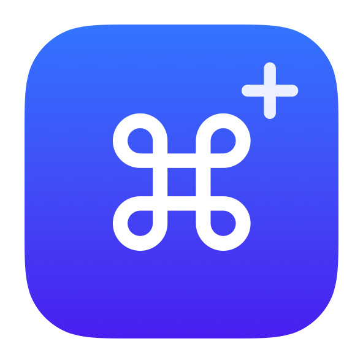
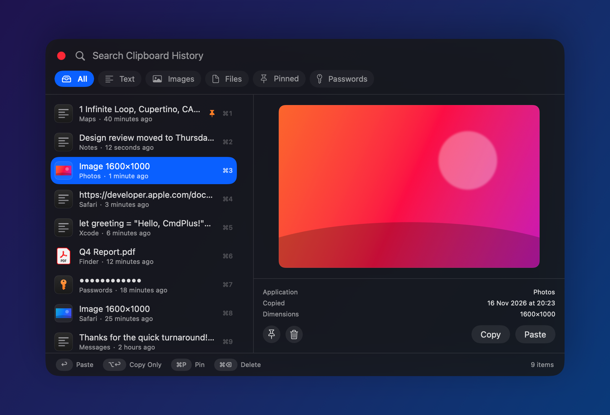

<div align="center">



# CmdPlus

**Small, native utilities for your Mac — all in one menu bar app.**

Free and open source. Fast, private, and built only with Apple's own frameworks.

[](#requirements)
[](#building)
[](LICENSE)

<br>

<picture>
  <source media="(prefers-color-scheme: dark)" srcset="docs/images/history-dark.png">
  <source media="(prefers-color-scheme: light)" srcset="docs/images/history-light.png">
  
</picture>

</div>

## Why CmdPlus

Instead of a dozen separate menu bar apps, CmdPlus gives you one lightweight app with modules you can switch on and off.

- 🍏 **Native.** Swift and SwiftUI, system components only, designed for macOS 26 and Liquid Glass.
- ⚡️ **Light on resources.** Disabled modules aren't even loaded. Heavy work runs in the background.
- 🔒 **Private.** Everything stays on your Mac. No accounts, no servers, no analytics.
- 🧩 **Modular.** Use only what you need, and turn the rest off in Settings.

## Clipboard History

Everything you copy (text, images, files) is one shortcut away.

- **⇧⌘V** opens a Spotlight-style window: the list is on the left, a full preview on the right.
- **Search by words** in any order, with matches highlighted. Filter by text, images, files, pinned or passwords.
- **Pick and it's pasted** straight into the app you were using. No extra ⌘V needed.
- **Drag and drop** items into any app: text as text, images as PNG, files as files.
- **Pin** what you use often. Pinned items never count toward the limit.
- **Set your own limit** from 1 to 500 items. The oldest unpinned ones are removed first.
- **Passwords stay safe.** Anything copied from a password manager is stored only in this Mac's Keychain. It is never synced, is shown as dots, is revealed with Touch ID and expires automatically.

<details>
<summary><b>Keyboard shortcuts</b></summary>
<br>

| Shortcut | Action |
| --- | --- |
| <kbd>⇧</kbd><kbd>⌘</kbd><kbd>V</kbd> | Open the history window, bring it forward, or close it |
| <kbd>↑</kbd> <kbd>↓</kbd> | Move the selection |
| <kbd>↩</kbd> or double-click | Paste the item |
| <kbd>⌥</kbd><kbd>↩</kbd> | Copy without pasting |
| <kbd>⌘</kbd><kbd>1</kbd> … <kbd>⌘</kbd><kbd>9</kbd> | Paste one of the first nine items |
| <kbd>⌘</kbd><kbd>P</kbd> | Pin or unpin |
| <kbd>⌘</kbd><kbd>⌫</kbd> | Delete |
| <kbd>esc</kbd> | Close |

</details>

<div align="center">

</div>

## Requirements

- macOS 26 or later
- To build: Xcode 27 or later

## Building

```sh
git clone https://github.com/GostWarrir186/CmdPlus.git
open CmdPlus/CmdPlus.xcodeproj
```

1. In **Signing & Capabilities**, choose your own team. The project is signed with the author's team by default.
2. Press <kbd>⌘</kbd><kbd>R</kbd>. CmdPlus appears in the menu bar. It has no Dock icon.

Run the tests with <kbd>⌘</kbd><kbd>U</kbd>, or from the terminal:

```sh
xcodebuild -project CmdPlus.xcodeproj -scheme CmdPlus -destination 'platform=macOS' test
```

<details>
<summary>Regenerating the README screenshots</summary>
<br>

Screenshots are rendered from demo data by a test, so no real clipboard history ends up in the repo:

```sh
TEST_RUNNER_CMDPLUS_SCREENSHOTS=1 xcodebuild test -project CmdPlus.xcodeproj -scheme CmdPlus \
  -destination 'platform=macOS' -testLanguage en -only-testing:CmdPlusTests/ReadmeScreenshots \
  | grep '^SCREENSHOT ' | while read _ name data; do echo "$data" | base64 -D > "docs/images/$name.png"; done
```

</details>

## Permissions

CmdPlus asks for a permission only when you turn on the feature that needs it, and always explains why.

| Permission | Used for |
| --- | --- |
| **Accessibility** | Pasting a picked history item for you by sending ⌘V. Without it, items are only copied. |
| **Touch ID / password** | Revealing or pasting a saved password. |

## Privacy

- Settings are stored in `UserDefaults`.
- History is stored in the app's sandbox container: `~/Library/Containers/com.azam.CmdPlus/Data/Library/Application Support/CmdPlus/`.
- Passwords are stored only in the Keychain. They are never written to disk in plain text and never leave your Mac.
- Clipboard History never goes online. The only planned network access is currency rates and update checks.

## Roadmap

- [x] App shell and **Clipboard History**
- [ ] Reverse mouse scrolling
- [ ] Window management
- [ ] File converter
- [ ] System monitor
- [ ] Small tools: sleep and power, QR and Wi-Fi, currency rates, color picker, text converter, hide menu bar icons, Windows-friendly shortcuts
- [ ] 1.0 polish: onboarding, more languages, "What's New", settings export, app icon, release builds

## Contributing

Issues and pull requests are welcome. Please keep the spirit of the project: native, fast and private.

## License

CmdPlus is available under the [MIT License](LICENSE).
